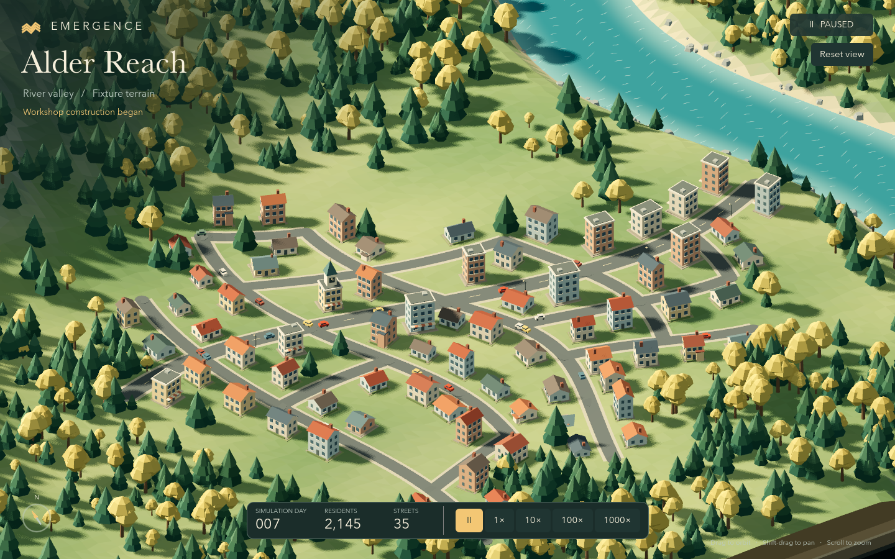

# EMERGENCE

Watch a settlement grow along a wooded river valley. As housing fills, the town opens streets, develops roadside lots, and makes room for new residents. Twenty-two vehicles choose destinations and drive through the changing street network.



[Opening settlement](captures/alder-reach.png) · [Eight seconds of growth at 10×](captures/growth.mp4)

## Play on Apple Silicon

Open `dist/EMERGENCE.app` after exporting the project. The application starts immediately in Alder Reach. Select **10×** to watch streets open and construction finish in seconds. One day lasts 24 seconds at normal speed.

| Action | Control |
| --- | --- |
| Orbit | Drag |
| Pan | Shift-drag, middle-drag, or trackpad pan |
| Zoom | Scroll or pinch |
| Return to the opening view | H or Reset view |
| Pause and resume the previous speed | Space or the pause button |
| Choose 1×, 10×, 100×, or 1000× | Keys 1–4 or the speed buttons |

## Build from source

Use an Apple Silicon Mac with a C++20 compiler, CMake 3.20 or later, Python 3, and the standard Godot 4.4.1 macOS application. Set `GODOT` to the full path of the Godot executable. The editor and export templates are available from the [Godot 4.4.1 archive](https://godotengine.org/download/archive/4.4.1-stable/).

```sh
git clone --depth 1 --branch godot-4.4.1-stable https://github.com/godotengine/godot-cpp.git vendor/godot-cpp
cmake -S . -B build -DCMAKE_BUILD_TYPE=Release
cmake --build build --parallel
ctest --test-dir build --output-on-failure

export GODOT="/Applications/Godot.app/Contents/MacOS/Godot"
"$GODOT" --headless --path game --import
"$GODOT" --path game
```

For an app bundle, install the matching export templates through Godot and run the following. The script also accepts the path to the official `macos.zip` extracted from the template package. It takes the arm64 slice of the official runtime and verifies the exported app's ad-hoc signature.

```sh
tools/export-macos.sh
open dist/EMERGENCE.app
```

The Godot runtime, dependency checkout, and build outputs stay local. All landscape geometry, buildings, vehicles, water, and vegetation are generated by the project.

## The vertical slice

The fixture is a 432 × 328 metre landscape. The opening settlement has a market street and several short side streets. Every four ticks, immigration can fill completed housing. At high occupancy the planner periodically evaluates road extensions or infill sites. Each new building takes 24 ticks to complete, at which point its housing capacity comes online. Vehicles choose a new destination at the end of a trip and follow the graph through intersections.

The default seed is 147. At tick zero it has **1,507 residents, 23 streets, and 44 buildings**. At tick 640 it has **2,145 residents, 35 streets, and 72 buildings**. The two screenshots use the same camera and seed. To repeat the capture, pass an absolute image path.

```sh
"$GODOT" --path game --resolution 1440x900 -- --seed=147 --at=640 --capture="$PWD/captures/day-seven.png"
```

## Architecture

| Module | Responsibility |
| --- | --- |
| `geo/` | Terrain height, water level relative to local ground, and fixture street coordinates in metres. The analytical fixture supplies the same surface to planning and rendering. |
| `sim/` | Seeded random stream, fixed ticks, population, completed housing, construction, append-only road graph, route selection, and event history. This library compiles independently of Godot. |
| `replay/` | Versioned checkpoints containing seed, tick, and a state checksum. Restoration replays the simulation and verifies the checksum. Restore time scales with elapsed ticks. |
| `extension/` | A narrow GDExtension adapter. It supplies road polylines, building records, statistics, and packed vehicle poses to the scene. |
| `game/` | Godot Forward+ presentation, terrain mesh, instanced forest, animated water and construction, camera, and observer controls. Rendering interpolates between fixed simulation ticks. |

## Engineering limits of this milestone

- **Road geometry.** The planner explores adjacent points on a warped lattice, ranks expansion cost and connectivity, and rejects water, steep grades, and existing building footprints. Shared endpoints give vehicles navigable intersections. Free-angle crossings and bridges will require edge splitting and explicit deck elevations.
- **Terrain integration.** A single height sampler keeps planning and road rendering aligned. Real elevation tiles will need a projected local origin, shared elevation datum, shoreline masks, and a street grading pass. The current location is fictional.
- **Time and reproducibility.** The tests compare identical seeds across different tick batches on the same build. Floating-point terrain sampling makes bit-identical replay across different math libraries a separate validation task.
- **Growth horizon.** This model fills a finite site and reaches capacity. Household aging, employment, congestion, freight, redevelopment, and decline belong to later milestones.

## Verification and profiling

Run the C++ suite without Godot or the extension dependency:

```sh
cmake -S . -B build-core -DCITY_EXTENSION=OFF -DCMAKE_BUILD_TYPE=Release
cmake --build build-core --parallel
ctest --test-dir build-core --output-on-failure
./build-core/city_profile
```

The profiling executable advances 40,000 ticks and reports elapsed time and city size. Its measurement covers the core simulation, including the period after buildable lots fill. Use Godot's frame profiler for rendering costs.

After building the extension and importing the project, run the integration checks:

```sh
"$GODOT" --headless --path game --script ../tests/playable.gd
```

These checks exercise pause, every speed, camera motion and reset, visible growth, and vehicle movement using the playable scene. The native tests cover multiple seeds, batch equivalence, checkpoint recovery, population capacity, and road and vehicle bounds.
