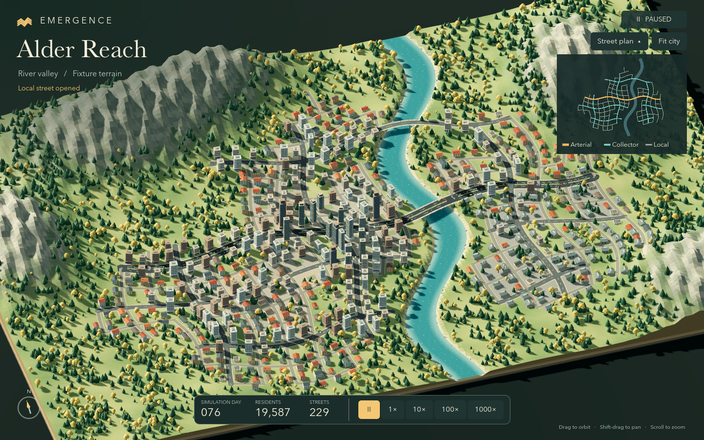

# EMERGENCE

Watch Alder Reach grow from a market town into a compact city on both banks of a river. The boulevard reaches across the water, collectors feed the surrounding neighborhoods, workshops gather on the east bank, and central parcels are rebuilt with taller buildings.



[18-second growth film at 100×](captures/growth.mp4) · [Downtown street detail](captures/market-district.png)

## Play on Apple Silicon

Open `dist/EMERGENCE.app` after exporting. The camera follows the footprint of the city at the opening speed of **10×**. Select **100×** to see roughly 75 simulation days in 18 seconds. The street plan in the upper right traces the actual network. Gold marks arterials, teal marks collectors, and thin pale lines mark local streets.

| Action | Control |
| --- | --- |
| Orbit and take control of the camera | Drag |
| Pan | Shift-drag, middle-drag, or trackpad pan |
| Zoom | Scroll or pinch |
| Frame the current city and resume tracking | H or Fit city |
| Show or hide the network map | Street plan |
| Pause and resume the previous speed | Space or the pause button |
| Choose 1×, 10×, 100×, or 1000× | Keys 1–4 or the speed buttons |

## Build from source

Use an Apple Silicon Mac with a C++20 compiler, CMake 3.20 or later, Python 3, and the standard Godot 4.4.1 macOS application. Set `GODOT` to the full path of the Godot executable. The editor and export templates are available from the [Godot 4.4.1 archive](https://godotengine.org/download/archive/4.4.1-stable/).

```sh
git clone --depth 1 --branch godot-4.4.1-stable https://github.com/godotengine/godot-cpp.git vendor/godot-cpp
cmake -S . -B build -DCMAKE_BUILD_TYPE=Release
cmake --build build --parallel
ctest --test-dir build --output-on-failure

export GODOT="/Applications/Godot.app/Contents/MacOS/Godot"
"$GODOT" --headless --path game --import
"$GODOT" --path game
```

For an app bundle, install the matching export templates through Godot and run the following. The script also accepts the path to the official `macos.zip` extracted from the template package. It takes the arm64 slice of the official runtime and verifies the exported app's ad-hoc signature.

```sh
tools/export-macos.sh
open dist/EMERGENCE.app
```

The Godot runtime, dependency checkout, and build outputs stay local. All landscape geometry, buildings, vehicles, water, and vegetation are generated by the project.

## The vertical slice

The fixture covers **960 × 640 metres**. Housing demand funds construction and unlocks expansion toward six district sites. The planner reserves through corridors, connects district centers and fills neighboring blocks. On developed central parcels, redevelopment increases height and housing capacity. Additional capacity becomes available when construction finishes.

| Road class | Carriageway | Function |
| --- | --- | --- |
| Arterial | 14.2 m | Four lanes, a planted median, and the first river crossing |
| Collector | 7.2 m | Marked two-lane streets connecting districts and a later northern crossing |
| Local | 4.2 m | Narrow unmarked residential access streets |

Vehicles use least-travel-time paths. Length and street class determine edge cost, speed and lane position. The traffic sample increases with population. Bridge decks use a shared elevation profile for the road mesh and vehicles.

Three captures use seed 147 and one locked regional camera. Span measures the east–west distance between the outermost building centers.

| Simulation day | Residents | Buildings | Street segments | Span | Image |
| --- | ---: | ---: | ---: | ---: | --- |
| 1 | 1,405 | 43 | 23 | 197 m | [Opening settlement](captures/region-0.png) |
| 17 | 4,964 | 144 | 74 | 611 m | [Growth across the river](captures/region-1600.png) |
| 76 | 19,587 | 479 | 229 | 723 m | [Both river crossings](captures/region-7200.png) |

Repeat a capture with an absolute image path. Drop `--atlas` to use automatic framing, or use `--detail` for the market district.

```sh
"$GODOT" --path game --resolution 1440x900 -- --seed=147 --atlas --at=7200 --capture="$PWD/captures/region-7200.png"
```

## Architecture

| Module | Responsibility |
| --- | --- |
| `geo/` | Terrain height, water level relative to local ground, and fixture street coordinates in metres. The analytical fixture supplies the same surface to planning and rendering. |
| `sim/` | Seeded random stream, fixed ticks, population, completed housing, construction, append-only road graph, route selection, and event history. This library compiles independently of Godot. |
| `replay/` | Version 2 checkpoints contain seed, tick, and a state checksum. Version 1 checkpoints belong to the earlier growth rules. Restoration replays the simulation and verifies the checksum. Restore time scales with elapsed ticks. |
| `extension/` | A narrow GDExtension adapter. It supplies road polylines, building records, statistics, and packed vehicle poses to the scene. |
| `game/` | Godot Forward+ presentation, terrain mesh, instanced forest, animated water and construction, camera, and observer controls. Rendering interpolates between fixed simulation ticks. |

## Engineering limits of this milestone

- **Road geometry.** The planner explores adjacent points on a warped lattice, ranks expansion cost and connectivity, and rejects water, steep grades, and existing building footprints. Shared endpoints give vehicles navigable intersections. Two reserved crossings connect dry banks. District sites and major rights of way are fixture inputs. A free-angle planner for arbitrary geography will also need edge splitting and bridge-site selection.
- **Terrain integration.** A single height sampler keeps planning and road rendering aligned. Real elevation tiles will need a projected local origin, shared elevation datum, shoreline masks, and a street grading pass. The current location is fictional.
- **Time and reproducibility.** The tests compare identical seeds across different tick batches on the same build. Floating-point terrain sampling makes bit-identical replay across different math libraries a separate validation task.
- **Growth horizon.** This model fills a finite site and reaches capacity. Household aging, employment-based trips, congestion, freight, and decline belong to later milestones.

## Verification and profiling

Run the C++ suite without Godot or the extension dependency:

```sh
cmake -S . -B build-core -DCITY_EXTENSION=OFF -DCMAKE_BUILD_TYPE=Release
cmake --build build-core --parallel
ctest --test-dir build-core --output-on-failure
./build-core/city_profile
```

The profiling executable advances 40,000 ticks and reports elapsed time and city size. Its measurement covers the core simulation, including the period after buildable lots fill. Use Godot's frame profiler for rendering costs.

After building the extension and importing the project, run the integration checks:

```sh
"$GODOT" --headless --path game --script ../tests/playable.gd
```

These checks exercise pause, every speed, camera motion and reset, visible growth, and vehicle movement using the playable scene. The native tests cover multiple seeds, batch equivalence, checkpoint recovery, population capacity, road and vehicle bounds, redevelopment, both bridge decks, and expansion to the far bank.
