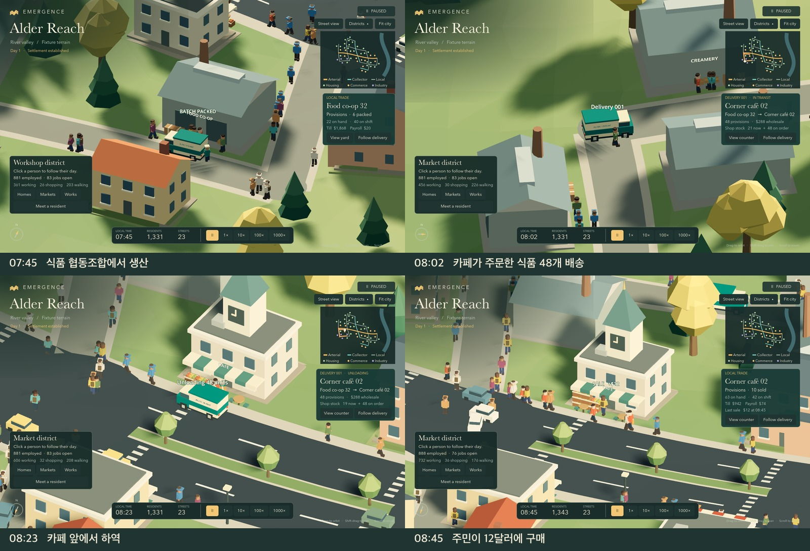

# EMERGENCE

Alder Reach opens at 07:45. On the market street, commuters pass the bakery on their way to work. Click one to see their name, home, employer, and destination, then follow them through lunch and back home. Zoom out to watch the settlement grow on both sides of the river.



[Follow a café delivery and sale](captures/local-trade.mp4) · [Watch Lina Gray’s day in 17 seconds](captures/resident-day.mp4) · [Morning commute at full resolution](captures/morning-commute.png)

## Play on Apple Silicon

Open `dist/EMERGENCE.app` after exporting. The simulation starts at **1×** with one local minute passing per real second. At **10×**, a full day takes 2 minutes 24 seconds. Use **1000×** to watch streets extend, districts form and downtown lots redevelop. The district map marks arterials in gold, collectors in teal and local streets with thin pale lines. Green, amber and purple parcels show housing, commerce and industry.

| Action | Control |
| --- | --- |
| Inspect a shop or factory | Click the building, or select Markets or Works and then View counter or View yard |
| Track a wholesale order until the van finishes unloading | Follow delivery in the Local Trade panel |
| Follow a pedestrian | Click the person or choose Meet a resident |
| Visit a residential street, market or industrial yard | Homes, Markets or Works |
| Return to the market street | V or Street view |
| Orbit and take control of the camera | Drag |
| Pan | Shift-drag, middle-drag, or trackpad pan |
| Zoom | Scroll or pinch |
| Frame the current city and resume tracking | H or Fit city |
| Show or hide the network map | Districts |
| Pause and resume the previous speed | Space or the pause button |
| Choose 1×, 10×, 100×, or 1000× | Keys 1–4 or the speed buttons |

## Build from source

Use an Apple Silicon Mac with a C++20 compiler, CMake 3.20 or later, Python 3, and the standard Godot 4.4.1 macOS application. Set `GODOT` to the full path of the Godot executable. The editor and export templates are available from the [Godot 4.4.1 archive](https://godotengine.org/download/archive/4.4.1-stable/).

```sh
git clone --depth 1 --branch godot-4.4.1-stable https://github.com/godotengine/godot-cpp.git vendor/godot-cpp
cmake -S . -B build -DCMAKE_BUILD_TYPE=Release
cmake --build build --parallel
ctest --test-dir build --output-on-failure

export GODOT="/Applications/Godot.app/Contents/MacOS/Godot"
"$GODOT" --headless --path game --import
"$GODOT" --path game
```

For an app bundle, install the matching export templates through Godot and run the following. The script also accepts the path to the official `macos.zip` extracted from the template package. It takes the arm64 slice of the official runtime and verifies the exported app's ad-hoc signature.

```sh
tools/export-macos.sh
open dist/EMERGENCE.app
```

The Godot runtime, dependency checkout, and build outputs stay local. All landscape geometry, buildings, vehicles, water, and vegetation are generated by the project.

## The vertical slice

The fixture covers **960 × 640 metres**. Housing demand funds construction and unlocks expansion toward six district sites. The planner reserves through corridors, connects district centers and fills neighboring blocks. On developed central parcels, redevelopment increases height and housing capacity. Additional capacity becomes available when construction finishes.

Every resident has a persistent address. Finished housing admits new residents, and shops and industrial workplaces hire up to their job capacity. Residents seeking work are matched against openings with a preference for nearby workplaces. Occupied housing and employment demand also influence new construction.

With seed 147 the town opens with 1,331 residents, 881 employed and 83 vacancies. Workers walk to assigned workplaces, visit nearby shops for lunch, return to work and walk home. Other residents run daytime errands from home. Building occupancy and the activity counters follow those individual schedules. A camera-dependent sample supplies the visible crowd. Industrial yards show workers carrying cartons, and occupied windows light up at dusk.

### Local trade

Food producers supply bakeries, cafés and grocers. Textile mills supply outfitters. Each open business has its own inventory and cash account. Staff on shift earn staggered hourly payments from their employer’s till, and staffed workshops pack goods up to their storage limit. Residents with enough money buy one item during a shop visit. A successful sale transfers $12, removes one item from the shelf, and gives the shopper a receipt and a shopping bag.

A shop running low can spend $6 per unit on a wholesale order. A staffed supplier with matching stock and a free delivery van packs up to 48 units. The cargo remains on order until the van reaches the shop’s curb and the driver finishes unloading. Empty shelves, insufficient funds or a lack of staff can prevent a sale. The right-hand panel shows the selected business’s stock, sales or output, till and payroll. Following a delivery shows the manifest and highlights its route on the map.

The opening settlement starts with savings, working capital and shelf stock. This slice uses fixed prices, two commodity categories and a ten-minute trading interval. It omits raw-material supply chains, rents, loans and ownership transfers. A new business or arriving resident brings its own opening capital.

| Road class | Carriageway | Function |
| --- | --- | --- |
| Arterial | 14.2 m | Four lanes, a planted median, and the first river crossing |
| Collector | 7.2 m | Marked two-lane streets connecting districts and a later northern crossing |
| Local | 4.2 m | Narrow unmarked residential access streets |

Vehicles use least-travel-time paths. Length and street class determine edge cost, speed and lane position. The traffic sample increases with population. Bridge decks use a shared elevation profile for the road mesh and vehicles.

The earlier regional growth study shows the settlement’s footprint from one fixed camera as the arterial and a second collector cross the river. These captures use the previous simulation clock and seed rules. [Opening settlement](captures/region-0.png) · [Growth across the river](captures/region-1600.png) · [Both river crossings](captures/region-7200.png) · [Regional growth film](captures/growth.mp4)

To reproduce the lunch scene, follow resident #1301 (zero-based ID 1300) at tick 1110. Four ticks advance the clock by one minute. Use `--district=0`, `1` or `2` for a housing, market or industrial view, or `--atlas` for a fixed regional camera.

```sh
"$GODOT" --path game --resolution 1440x900 -- --seed=147 --resident=1300 --at=1110 --capture="$PWD/captures/lunch.png"
```

## Architecture

| Module | Responsibility |
| --- | --- |
| `geo/` | Terrain height, water level relative to local ground, and fixture street coordinates in metres. The analytical fixture supplies the same surface to planning and rendering. |
| `sim/` | Seeded random stream, fixed ticks, population, completed housing, construction, append-only road graph, route selection, resident schedules, job assignment, cached sidewalk paths, local production and trade, freight routing, and event history. This library compiles independently of Godot. |
| `replay/` | Version 4 checkpoints contain the seed, tick, and a state checksum which includes resident assignments, shop accounts, wallets and cargo in transit. Older versions use different growth and clock rules. Restoration replays the simulation and verifies the checksum. Restore time scales with elapsed ticks. |
| `extension/` | A narrow GDExtension adapter. It supplies road polylines, building records, statistics, resident records and itineraries, and packed vehicle and pedestrian poses to the scene. |
| `game/` | Godot Forward+ presentation, terrain mesh, instanced forest, animated water and construction, camera, and observer controls. Rendering interpolates between fixed simulation ticks. |

## Engineering limits of this milestone

- **Road geometry.** The planner explores adjacent points on a warped lattice, ranks expansion cost and connectivity, and rejects water, steep grades, and existing building footprints. Shared endpoints give vehicles navigable intersections. Two reserved crossings connect dry banks. District sites and major rights of way are fixture inputs. A free-angle planner for arbitrary geography will also need edge splitting and bridge-site selection.
- **Terrain integration.** A single height sampler keeps planning and road rendering aligned. Real elevation tiles will need a projected local origin, shared elevation datum, shoreline masks, and a street grading pass. The current location is fictional.
- **Time and reproducibility.** The tests compare identical seeds across different tick batches on the same build. Floating-point terrain sampling makes bit-identical replay across different math libraries a separate validation task.
- **Growth horizon.** This model fills a finite site and reaches capacity. Car traffic runs independently of the individual pedestrian itineraries. Delivery vans carry actual wholesale orders. Household aging, road congestion and business closures remain future work.

## Verification and profiling

Run the C++ suite without Godot or the extension dependency:

```sh
cmake -S . -B build-core -DCITY_EXTENSION=OFF -DCMAKE_BUILD_TYPE=Release
cmake --build build-core --parallel
ctest --test-dir build-core --output-on-failure
./build-core/city_profile
```

The profiling executable advances 40,000 ticks and reports elapsed time and city size. Its measurement covers the core simulation, over approximately seven local days. Use Godot's frame profiler for rendering costs.

After building the extension and importing the project, run the integration checks:

```sh
"$GODOT" --headless --path game --script ../tests/playable.gd
```

These checks exercise pause, every speed, camera motion and reset, visible growth, vehicle movement, district views and resident selection using the playable scene. The native tests cover multiple seeds, batch equivalence, checkpoint recovery, population capacity, road and vehicle bounds, redevelopment, both bridge decks, expansion to the far bank, finite home and job capacities, and a resident’s commute, lunch trip and return home.

The market checks reconcile sales with wallets and payroll with business expenses, conserve cash and stock across transfers, and verify that goods enter shop inventory after unloading. To inspect the opening café’s delivery use `--counter=1 --freight` after Godot’s `--` argument separator.
