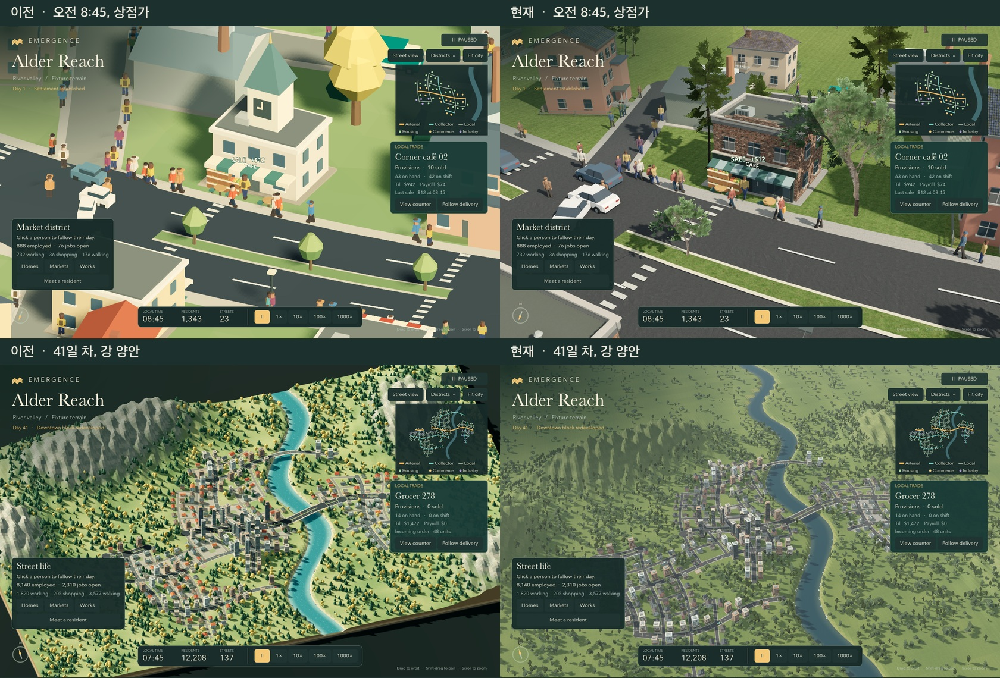

# EMERGENCE

Choose a point on Earth and descend from the map to a new settlement on its measured terrain. Gimje Plain, the Loire Valley and the Sacramento Valley are bundled for offline play. [Watch the flight into Gimje](captures/settlement-flight.mp4)

The original Alder Reach fixture opens at 07:45. On the market street, commuters pass the bakery on their way to work. Click one to see their name, home, employer, and destination, then follow them through lunch and back home. Zoom out to watch the settlement grow on both sides of the river.



[Watch a street, a bridge and an eight-storey redevelopment under construction](captures/construction.mp4) · [Construction stages](captures/construction-stages.jpg)

[Street detail](captures/alder-street.jpg) · [Downtown in daylight](captures/alder-downtown.jpg) · [Night streets](captures/alder-night.jpg)

[Watch a new playground take shape and children use the slide](captures/neighbourhood-parks.mp4) · [Watch the morning bus and a resident’s drive to work](captures/bus-commute.mp4) · [Follow a café delivery and sale](captures/local-trade.mp4) · [Watch Lina Gray’s day in 17 seconds](captures/resident-day.mp4) · [Morning commute at full resolution](captures/morning-commute.png)

## Play on Apple Silicon

Open `dist/EMERGENCE.app` after exporting. Click the map, search for a city in English or Korean, or paste latitude and longitude or a Google Maps place URL. Select **이곳에 정착** to survey the site and descend. In the city, **M** opens the map. Returning to the current city resumes play. Starting a new settlement replaces the current one.

The atlas uses Natural Earth cartography and Mapzen elevations. New locations require an internet connection for their initial survey. Each survey samples a 3.36 km square on a 20 m grid around the chosen coordinate. Surface detail depends on the source DEM. The central 960 × 640 m supports urban growth. The prototype uses sites between 85° south and 85° north where the founding neighbourhood fits on dry, gently sloping ground. The water model uses sea level and mapped Natural Earth lakes. Narrow rivers, minor lakes, dikes and below-sea-level land require finer hydrography. [Geographic data credits](game/art/atlas/credits.txt)

### Google Maps in the Mac app

Supplying the environment variable `EMERGENCE_GOOGLE_MAPS_KEY` opens an embedded Google map at startup. Enable the Maps JavaScript API for the browser key and restrict its website origin to `http://127.0.0.1:43861/*`. Run `dist/EMERGENCE.app/Contents/MacOS/EMERGENCE` from the shell containing the variable. The page stays on loopback, WebKit loads Google's SDK, and a click passes the selected latitude and longitude to the terrain importer. Google renders its map through the zoom. The 3D city uses the independently sampled elevation grid. The key is read at runtime. [Google setup instructions](https://developers.google.com/maps/documentation/javascript/get-api-key)

Without a key, the built-in atlas opens directly. The Google 지도 ↗ button opens Google Maps in the browser. Copy a coordinate or place link back into the atlas search field.

The simulation starts at **1×** with one local minute passing per real second. At **10×**, a full day takes 2 minutes 24 seconds. Use **1000×** to watch streets extend, districts form and downtown lots redevelop. The district map marks arterials in gold, collectors in teal and local streets with thin pale lines. Green, amber and purple parcels show housing, commerce and industry.

| Action | Control |
| --- | --- |
| Inspect a shop or factory | Click the building, or select Markets or Works and then View counter or View yard |
| Track a wholesale order until the van finishes unloading | Follow delivery in the Local Trade panel |
| Visit parks and playgrounds and view current attendance | P, Parks, or click the grounds |
| Follow the nearest active construction project | G or Construction |
| Follow a resident | Click a pedestrian or private car, or choose Meet a resident |
| Follow Line 1 and see its next stop, queue and load | B, Follow bus, or click a bus |
| Follow a passenger through alighting and arrival | Meet a rider while following a bus |
| Visit a residential street, market or industrial yard | Homes, Markets or Works |
| Return to the market street | V or Street view |
| Orbit and take control of the camera | Drag |
| Pan | Shift-drag, middle-drag, or trackpad pan |
| Zoom | Scroll or pinch |
| Frame the current city and resume tracking | H or Fit city |
| Show or hide the network map | Districts |
| Pause and resume the previous speed | Space or the pause button |
| Choose 1×, 10×, 100×, or 1000× | Keys 1–4 or the speed buttons |

## Build from source

Use an Apple Silicon Mac with a C++20 compiler, CMake 3.20 or later, Python 3, and the standard Godot 4.4.1 macOS application. Set `GODOT` to the full path of the Godot executable. The editor and export templates are available from the [Godot 4.4.1 archive](https://godotengine.org/download/archive/4.4.1-stable/).

```sh
git clone --depth 1 --branch godot-4.4.1-stable https://github.com/godotengine/godot-cpp.git vendor/godot-cpp
cmake -S . -B build -DCMAKE_BUILD_TYPE=Release
cmake --build build --parallel
ctest --test-dir build --output-on-failure

export GODOT="/Applications/Godot.app/Contents/MacOS/Godot"
"$GODOT" --headless --path game --import
"$GODOT" --path game
```

For an app bundle, install the matching export templates through Godot and run the following. The script also accepts the path to the official `macos.zip` extracted from the template package. It takes the arm64 slice of the official runtime and verifies the exported app's ad-hoc signature.

```sh
tools/export-macos.sh
open dist/EMERGENCE.app
```

The Godot runtime, dependency checkout, and build outputs stay local. The application loads geographic terrain and generates settlement geometry and vehicles. Photo-based materials and instanced tree canopies are bundled for offline use. [Art sources](ART-CREDITS.md)

## The vertical slice

The fixture covers **960 × 640 metres**. Housing demand funds construction and unlocks expansion toward six district sites. The planner reserves through corridors, connects district centers and fills neighboring blocks. On developed central parcels, redevelopment increases height and housing capacity. Additional capacity becomes available when construction finishes.

New streets open in stages. A roller follows the roadbed as pavement, shoulders and markings extend toward the next junction. Bridges advance across the river on piers and girders. Cars, freight and pedestrians can use the connection from its opening tick. Foundations, exposed floor slabs and cranes precede finished facades. Redevelopment dismantles the existing building before the new frame goes up. The founding settlement is already occupied when play begins. At 10× a local street takes 12 seconds and a building takes 36 seconds. At 1000× the same projects finish in 0.12 and 0.36 seconds.

To watch the first street and its adjacent house from groundbreaking, launch with `-- --seed=147 --at=720 --site-road=23 --speed=10`. Press G to switch to following active sites.

Every resident has a persistent address. Finished housing admits new residents, and shops and industrial workplaces hire up to their job capacity. Residents seeking work are matched against openings with a preference for nearby workplaces. Occupied housing and employment demand also influence new construction.

With seed 147 the town opens with 1,331 residents, 881 employed and 83 vacancies. Among the workers, 727 walk, 78 drive and 76 take the bus. Each resident compares the door-to-door round trip for the destinations on their schedule. A private car requires access to a car and includes walking at both curbs and an individual parking penalty. A bus journey includes walking on the sidewalk network, waiting for a scheduled departure, a seat on each segment, and the walk to the destination. Workers visit nearby shops on foot during their lunch break. Residents without jobs make their own mode choices for trips to the shops.

The founding road graph determines the route of **Line 1**. Four buses circulate in two directions, serving each direction every 18 city minutes. Each vehicle holds 32 passengers and opens its doors at each two-minute stop. A full segment pushes subsequent riders to a later departure or another option. Click a private car to inspect its driver, or press **B** and select **Meet a rider**. The city map highlights the line, stops and tracked bus. To start alongside the morning queue in the fixture, launch with `-- --fixture --at=79 --bus=0`.

Building occupancy, workers on shift and shoppers at the till follow these schedules. A camera-dependent sample supplies the visible crowd. Industrial yards show workers carrying cartons, and occupied windows light up at dusk.

### Parks and playgrounds

The municipal planner looks for homes with poor walking access to an existing garden or playground. It uses the open street graph, housing around the proposed entrance, ground slope, water, factory buffers and available space. Playgrounds also require clearance from arterials. The selected grounds and entrance remain reserved as streets and buildings expand.

Each site opens after 180 city minutes of landscaping. Residents fit walks into free time around work and shopping, linger along the garden path and return home. Some residents are children throughout this prototype. Children walk to play areas and take turns climbing the ladder and using the slide. Press **P** to cycle between facilities. The district map marks parks in green and playgrounds in coral.

### Local trade

Food producers supply bakeries, cafés and grocers. Textile mills supply outfitters. Each open business has its own inventory and cash account. Staff on shift earn staggered hourly payments from their employer’s till, and staffed workshops pack goods up to their storage limit. Residents with enough money buy one item during a shop visit. A successful sale transfers $12, removes one item from the shelf, and gives the shopper a receipt and a shopping bag.

A shop running low can spend $6 per unit on a wholesale order. A staffed supplier with matching stock and a free delivery van packs up to 48 units. The cargo remains on order until the van reaches the shop’s curb and the driver finishes unloading. Empty shelves, insufficient funds or a lack of staff can prevent a sale. The right-hand panel shows the selected business’s stock, sales or output, till and payroll. Following a delivery shows the manifest and highlights its route on the map.

The opening settlement starts with savings, working capital and shelf stock. This slice uses fixed prices, two commodity categories and a ten-minute trading interval. It omits raw-material supply chains, rents, loans and ownership transfers. A new business or arriving resident brings its own opening capital.

| Road class | Carriageway | Function |
| --- | --- | --- |
| Arterial | 14.2 m | Four lanes, a planted median, and the first river crossing |
| Collector | 7.2 m | Marked two-lane streets connecting districts and a later northern crossing |
| Local | 4.2 m | Narrow unmarked residential access streets |

Vehicles use least-travel-time paths. Length and street class determine edge cost, speed and lane position. The traffic sample increases with population. Bridge decks use a shared elevation profile for the road mesh and vehicles.

The earlier regional growth study shows the settlement’s footprint from one fixed camera as the arterial and a second collector cross the river. These captures use the previous simulation clock and seed rules. [Opening settlement](captures/region-0.png) · [Growth across the river](captures/region-1600.png) · [Both river crossings](captures/region-7200.png) · [Regional growth film](captures/growth.mp4)

To reproduce the lunch scene, follow resident #1301 (zero-based ID 1300) at tick 1110. Four ticks advance the clock by one minute. Use `--district=0`, `1` or `2` for a housing, market or industrial view, or `--atlas` for a fixed regional camera.

```sh
"$GODOT" --path game --resolution 1440x900 -- --seed=147 --resident=1300 --at=1110 --capture="$PWD/captures/lunch.png"
```

## Architecture

| Module | Responsibility |
| --- | --- |
| `geo/` | Local east/south metre grid, water mask and central elevation datum, plus the original analytical fixture. Planning, traffic, walking and rendering sample the same site. |
| `sim/` | Seeded random stream, fixed ticks, population, completed housing, construction, append-only road graph, route selection, resident schedules, job assignment, cached sidewalk paths, local production and trade, freight routing, and event history. This library compiles independently of Godot. |
| `replay/` | Geographic checkpoints embed the coordinate, sampled heights and lake mask for offline replay. Fixture version 7 checkpoints contain the seed, tick, and a state checksum which includes road opening ticks, previous building heights, resident assignments, shop accounts, wallets, travel choices, scheduled bus runs, civic sites, leisure visits and cargo in transit. Older versions use different growth and clock rules. Restoration replays the simulation and verifies the checksum. Restore time scales with elapsed ticks. |
| `extension/` | A narrow GDExtension adapter. It supplies road polylines, building records, statistics, resident records and itineraries, and packed vehicle and pedestrian poses to the scene. |
| `game/` | Godot Forward+ presentation, terrain mesh, instanced forest, animated water and construction, camera, and observer controls. Rendering interpolates between fixed simulation ticks. |

## Engineering limits of this milestone

- **Road geometry.** The planner explores adjacent points on a warped lattice, ranks expansion cost and connectivity, and rejects water, steep grades, and existing building footprints. Shared endpoints give vehicles navigable intersections. Two reserved crossings connect dry banks. District sites and major rights of way are fixture inputs. A free-angle planner for arbitrary geography will also need edge splitting and bridge-site selection.
- **Terrain integration.** Imported sites have a shared metre-based height sampler. The present road planner keeps its warped lattice and fixed district targets. Real-site bridge placement, local street grading and detailed river masks are future work.
- **Time and reproducibility.** The tests compare identical seeds across different tick batches on the same build. Floating-point terrain sampling makes bit-identical replay across different math libraries a separate validation task.
- **Growth horizon.** This model fills a finite site and reaches capacity. Residents drive their own trips and delivery vans carry wholesale orders. Line 1 keeps its founding circuit as the city expands. Additional lines, transfers, congestion, household aging and business closures remain future work.

## Verification and profiling

Run the C++ suite without Godot or the extension dependency:

```sh
cmake -S . -B build-core -DCITY_EXTENSION=OFF -DCMAKE_BUILD_TYPE=Release
cmake --build build-core --parallel
ctest --test-dir build-core --output-on-failure
./build-core/city_profile
```

The profiling executable advances 40,000 ticks and reports elapsed time and city size. Its measurement covers the core simulation, over approximately seven local days. Use Godot's frame profiler for rendering costs.

After building the extension and importing the project, run the integration checks:

```sh
"$GODOT" --headless --path game --script ../tests/playable.gd
"$GODOT" --headless --path game --script ../tests/transport.gd
"$GODOT" --headless --path game --script ../tests/green_spaces.gd
"$GODOT" --headless --fixed-fps 30 --path game --script ../tests/settlement.gd
```

The map checks cover coordinate selection and search, the three bundled real sites, water rejection, the flight into the simulation and resuming a city. On macOS, running `"$GODOT" --path game --script ../tests/google_picker.gd` also exercises the embedded WebKit page using a local map test double. Live Google imagery requires a configured key.

The simulation checks exercise pause, every speed, camera motion and reset, visible growth, vehicle movement, district views and resident selection using the playable scene. The native tests cover multiple seeds, batch equivalence, checkpoint recovery, population capacity, road and vehicle bounds, redevelopment, both bridge decks, expansion to the far bank, finite home and job capacities, mode choice, segment capacity, boarding and arrival times, lunch trips and the return home. The transport scene test follows a waiting commuter into a moving bus and through the workplace door.

The market checks reconcile sales with wallets and payroll with business expenses, conserve cash and stock across transfers, and verify that goods enter shop inventory after unloading. To inspect the opening café’s delivery use `--counter=1 --freight` after Godot’s `--` argument separator.
